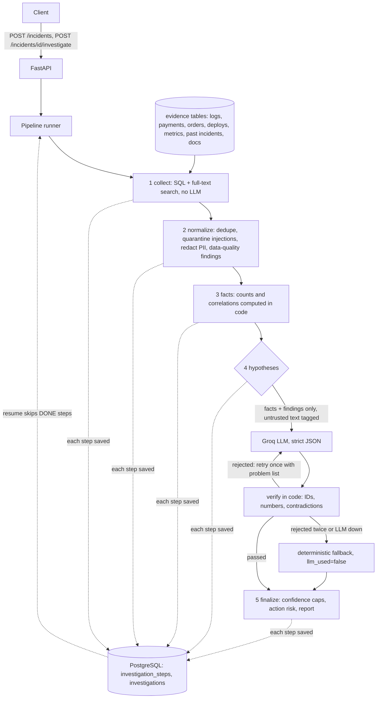

# Architecture

Where the LLM is used: only step 4. Where failure is handled: per-source errors in collect, per-fact errors in facts, retry then fallback in step 4, per-step persistence for resume.
